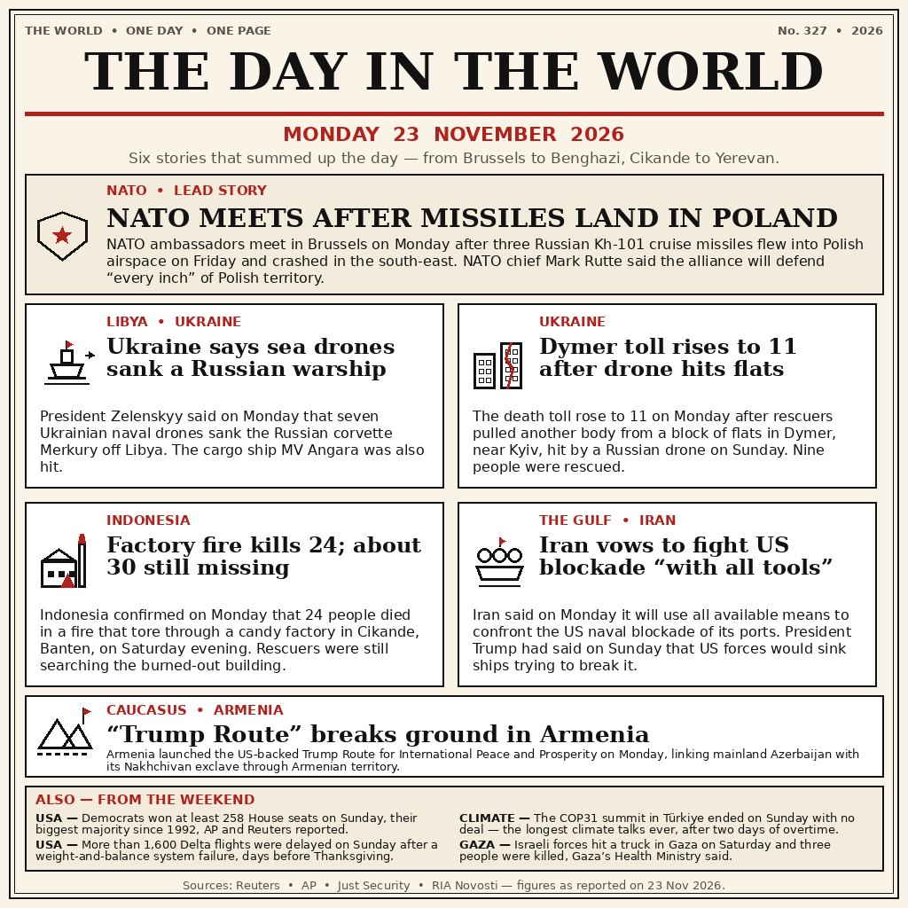

[](https://make.fun/bounty/news-image-20261123?utm_source=github&utm_medium=readme&utm_campaign=news-image-20261123)
[](https://make.fun/bounty/news-image-20261123/leaderboard?utm_source=github&utm_medium=readme&utm_campaign=news-image-20261123)
[](https://make.fun/bounty/news-image-20261123?utm_source=github&utm_medium=readme&utm_campaign=news-image-20261123)

# The Day in the World — Monday 23 November 2026

One page, six stories: a newspaper front page that sums up Monday
23 November 2026 in a single 1024 × 1024 image, built for the
[make.fun bounty](https://make.fun/bounty/news-image-20261123).

The idea is simple. A reader who has seen no news at all that day
should be able to look at this one picture and walk away knowing what
mattered: why NATO ambassadors were called to Brussels, what happened
off the Libyan coast and in a town near Kyiv, the factory fire in
Indonesia, the standoff in the Gulf, and the new road breaking ground
in Armenia — plus four weekend stories that were still shaping the
day. Every headline on the page is backed by live reporting from
that day; nothing on it is invented, and no number appears unless a
newsroom had actually reported it.



## What is on the page

**Lead story — NATO meets after missiles land in Poland.**
NATO ambassadors met in Brussels on Monday after three Russian
Kh-101 cruise missiles flew into Polish airspace on Friday and came
down in the south-east of the country. NATO chief Mark Rutte said the
alliance will defend "every inch" of Polish territory.
Sources: Reuters, AP.

**Ukraine says sea drones sank a Russian warship.**
President Zelenskyy said on Monday that seven Ukrainian naval drones
sank the Russian corvette Merkury off Libya, and that the cargo ship
MV Angara was hit as well. Sources: Reuters, Just Security.

**Dymer toll rises to 11 after drone hits flats.**
The death toll reached 11 on Monday after rescuers pulled another
body from a block of flats in Dymer, near Kyiv, struck by a Russian
drone on Sunday. Nine people were rescued. Sources: Reuters, AP.

**Factory fire kills 24; about 30 still missing.**
Indonesia confirmed on Monday that 24 people died in a fire that tore
through a candy factory in Cikande, Banten, on Saturday evening, and
that rescuers were still searching the burned-out building.
Sources: Reuters, AP.

**Iran vows to fight US blockade "with all tools".**
Iran said on Monday it will use all available means to confront the
US naval blockade of its ports, after President Trump said on Sunday
that US forces would sink ships trying to break it.
Sources: Reuters, AP.

**"Trump Route" breaks ground in Armenia.**
Armenia launched the US-backed Trump Route for International Peace and
Prosperity on Monday, linking mainland Azerbaijan with its Nakhchivan
exclave through Armenian territory. Sources: Reuters, RIA Novosti.

**Also, from the weekend:** Democrats won at least 258 House seats on
Sunday, their biggest majority since 1992 (AP, Reuters); the COP31
summit in Türkiye ended on Sunday with no deal, the longest climate
talks ever (Reuters); more than 1,600 Delta flights were delayed on
Sunday after a weight-and-balance system failure, days before
Thanksgiving (AP); Israeli forces hit a truck in Gaza on Saturday and
three people were killed, according to Gaza's Health Ministry
(Reuters).

## What was left out, and why

Two things were deliberately kept off the page. First, a claim that
an Iranian supertanker had been seized: it was circulating on the
day but could not be confirmed in reliable reporting, so it does not
appear anywhere in the image. Second, stories from earlier in the
week that were no longer the day's news — the brief only asks for
23 November itself, so older developments were left out even when
they were still being talked about.

## How it is made

The picture is drawn from scratch with Pillow — no photos, no
templates, no network calls. `build_image.py` holds the copy, the
layout and the small hand-drawn icons (a shield, a boat, tower
blocks, a factory, a tanker and mountain peaks), and paints the
1024 × 1024 front page to `image.png`. `main.py` is the competition
entry point: it copies that finished picture to
`$MAKEFUN_OUTPUT_DIR/entry.png` (default `/output/entry.png`).

Because every coordinate is fixed and nothing depends on the time,
the network or chance, the program produces identical bytes on every
run. That was checked by running it twice and comparing SHA-256
hashes of the outputs.

## Build and run

```bash
# needs Python 3.13 and Pillow
pip install pillow

# draw the front page
python3 build_image.py

# write the entry (defaults to /output/entry.png)
python3 main.py

# or point it somewhere else
MAKEFUN_OUTPUT_DIR=/tmp/out python3 main.py
```

## License

MIT — see [LICENSE](LICENSE).
